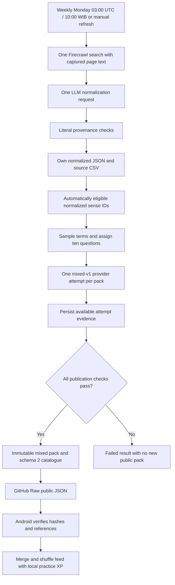
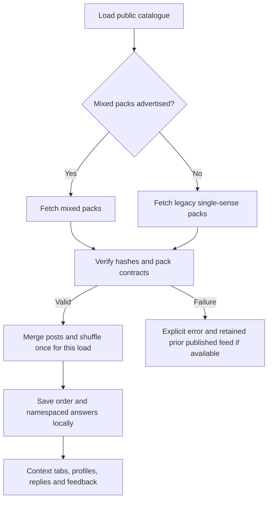

# Current architecture — normalized dataset and mixed feed

The user-approved product direction is an offline-generated, mixed-slang social feed. This page describes the implemented source contracts, not a deployment or test result. `0.5.0-mixed-feed` / Android version code `6` is planned for main to set; no successful release, fresh collection or live mixed generation is asserted here.

## Primary pipeline

- **Dataset:** `backend/data/discovered_candidates.json` is the active own dataset; its CSV records one row per source capture. The initial 16 entries retain their actual capture timestamps. A new refresh is pending. The old `slangfeed_snapshot.csv` is historical, not an active input or popularity feed.
- **Provenance:** exact collected URL, literal case-sensitive quote with whitespace tolerance, capture time, page hash and normalization model are retained. Eligible entries receive `normalized-<candidateId>` automatically; there is no manual review gate. `normalized-unreviewed` explicitly does not mean semantically correct or expert validated.
- **Selection:** `backend/src/mixedQuestions.mjs` samples distinct terms first, preferring ten; at least two distinct terms are required. With fewer than ten terms, assignments repeat selected senses until ten questions exist. Nominal difficulty is 5 easy / 3 medium / 2 hard. Each question links to its own embedded sense reference.
- **Contexts:** each mixed question declares one of nine `contextCategory` values. Categories and scenario IDs may repeat; neither ten unique contexts nor all nine categories per pack is required. Context suitability is a writing objective, not a semantic validator result.

## Generation, validation and publication

`backend/scripts/publish-mixed-bank.mjs` uses `src/mixedBank.mjs`, `mixedGeneration.mjs`, `mixedProvider.mjs` and `mixedQuestions.mjs`. Default budget: **one pack attempt**, hard maximum **three**, one provider invocation per attempt, **no retries, repair calls or mock fallback**. Separate attempts are not retries of a failed output. The versioned prompt is `backend/prompts/mixed-v1.txt`; no mixed-v2 experiment is claimed.

The nine explicit validator checks cover parsing, required fields, count, difficulty split, four options, answer-index range, context-category membership, unique question IDs and absence of surrounding text. Reference/assignment integrity, existing lexical question rules, deterministic social guardrails and provider-completion checks additionally gate publication. These establish contract compliance, not linguistic accuracy, plausible distractors, safe semantics or empirical difficulty. See [the research protocol](PROMPT_ENGINEERING.md).

Every attempt starts an audit directory under `backend/experiments/`. It records input/selection, rendered prompt, non-secret request, raw model content in `output.txt`, provider envelope in `response.txt`, metadata, validation and result when available; successful attempts also have `pack.json`. A pre-request failure cannot have a provider response. Logs preserve actual returned model, usage and finish reason without inventing missing values.

Successful packs are new immutable `question-bank/packs/<packId>.json` files. The schema 2 catalogue contains `packs` plus retained legacy `senses`, with exact-byte SHA-256 hashes. The current retention limit is twelve mixed catalogue entries; older files remain untouched. Valid old packs survive generation failures, and invalid/hash-mismatched files are not advertised. References embedded in an old pack are not rewritten to match a later dataset.

**Integration status:** `scripts/report-experiments.mjs` aggregates real attempt evidence into `summary.json`/`attempts.csv`, and the publisher workflow uploads artifacts and persists audit files plus valid additions even when generation fails. Do not interpret the older single-sense publisher workflow as proof this integration has run. GitHub distribution must publish a consistent catalogue and pack set. See [bank operations](GITHUB_GET_QUESTIONS.md).

## Android Home

Home prefers mixed `packs` and uses legacy `senses` only when no mixed packs are listed, not when mixed loading fails. It loads up to twelve selected packs and merges their posts, so the feed can contain more than ten questions even though each pack has ten. There are **no slang-selection chips**; the context tabs remain. `For you` is an unpersonalized mixed view, `News` means fictional event reactions, and Saved is a bookmark view.

A fresh load or explicit refresh shuffles the merged posts. Saved order is reused for the same loaded content during recomposition, navigation and supported activity recreation; a failed refresh does not reshuffle the prior feed. Answers use pack ID, content hash and question ID, isolating revisions and offline samples. Correct/incorrect practice XP remains 80/15, awarded once per question identity, not again for changing tabs or refreshing.

The phone only GETs public JSON. It has no provider secret and never generates questions live. Public packs necessarily expose answer keys; grading and Compose saveable state are local practice, not secure scores or durable participant records. The authored offline sample remains explicit opt-in, never a silent generation fallback.

## Separate compatibility path: Connected Training REST

The optional Node backend still supports single-sense, ten-distinct-scenario sessions, server-side grading, and labeled `mock`, `llm` or authored `fallback` sources. Its retry settings belong to that path, not the no-retry mixed publisher. A sense without an authored fallback returns an explicit error rather than substituting a different meaning. Historical authored senses remain resolvable but do not populate the active normalized catalogue.

Local development can run without a token; configured cloud gameplay uses a separate shared client token, not the provider key. Sessions expire after 30 minutes in process memory. Single-flight generation and a per-process fuse are not durable rate limiting or a spending cap. Health is not a live-provider success probe. See [API contracts](API_CONTRACT.md) and [optional cloud setup](CLOUD_PLAY.md).

## Evidence and research boundaries

Product approval of this pipeline is separate from supervisor approval of a thesis methodology. No accounts, authenticated competitive scoring, durable response export, participant study, calibrated item difficulty or learning gains are established by these contracts. Historical V2/V3 and 0.4.0 notes describe earlier checkpoints, not the current mixed generator. Use the [handbook](MIXED_FEED_HANDBOOK.md) for accepted intent and [implementation status](IMPLEMENTATION_STATUS.md) for remaining integration work; this document does not update final test results.
