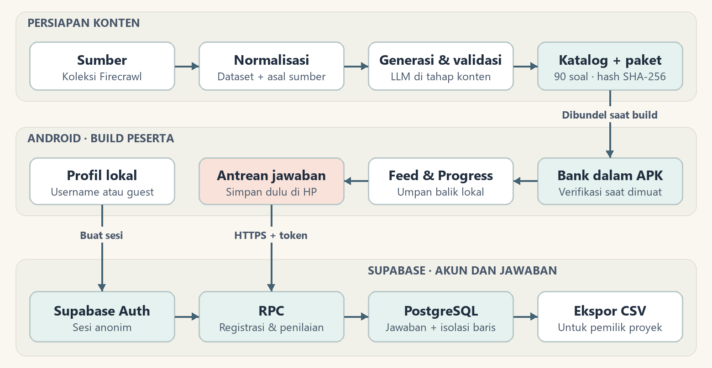
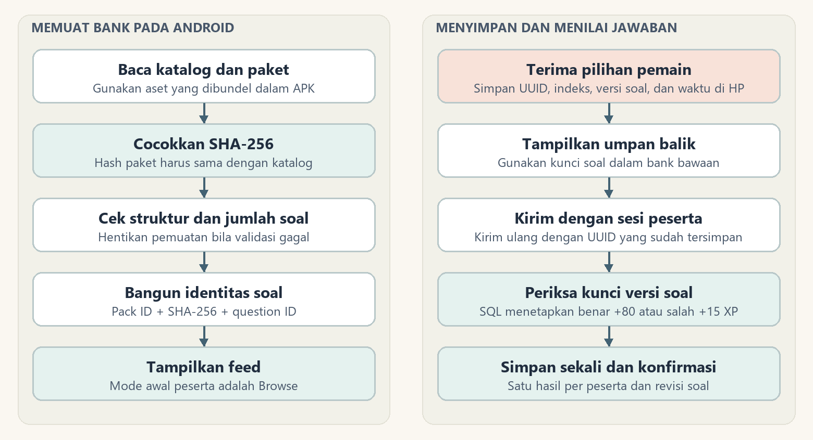
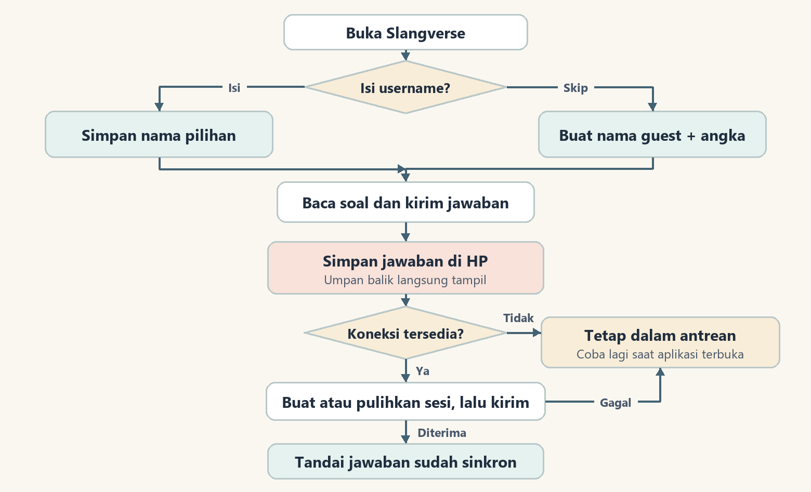

# Handbook Slangverse Android

**Versi 0.8.3 · Panduan aplikasi dan penelitian**

Rilis referensi 24 November 2026 (WIB) · Bank `7e1e593cea34524f` · Paket peserta `id.slangverse.app.staging`

## 1. Cara pakai dan cakupan rilis

Slangverse adalah gim Android untuk memahami slang internet lewat unggahan dan komentar fiktif. Pemain membaca konteks, memilih makna, lalu mendapat penjelasan. Bank peserta memuat **90 soal dalam sembilan paket**. Tiap paket punya lima target slang di unggahan dan lima di komentar.

1. Buka **Slangverse Staging**. Isi **Username** dengan nama panggilan, atau tekan **Skip** untuk mendapat nama seperti `guest123456789`. Aplikasi membuat identitas peserta secara otomatis tanpa email atau kata sandi.
2. Di **Feed**, lihat label unggahan atau komentar asli. Tekan **Answer Kai**, pilih makna, lalu **Send reply**. Jawaban benar memberi 80 XP, jawaban lain memberi 15 XP.
3. Buka **Progress** untuk melihat ringkasan dan riwayat jawaban. **Quests** menampilkan sasaran latihan. **Profile** menampilkan nama peserta dan status sinkronisasi.
4. Jika internet terputus, soal dari bank bawaan tetap bisa dimainkan. Buka aplikasi saat tersambung kembali agar jawaban yang tertunda terkirim. Setelah menjawab, cek **Answers synced** di **Profile**.

Satu instalasi mewakili satu ID peserta. Dua instalasi dapat memilih username yang sama dan tetap punya data terpisah. Membersihkan data aplikasi, memasang ulang setelah data terhapus, atau pindah HP memulai identitas baru.

Mode peserta digunakan oleh build debug yang diberi konfigurasi Supabase. Build reguler memakai latihan lokal dan mendukung pilihan Browse, Adaptive, serta Fixed order. Pada build peserta 0.8.3, bank dibundel dan pemilihan sumber serta pengaturan mode disembunyikan. Instalasi peserta yang baru memulai dalam mode Browse.

## 2. Arsitektur sistem



- **Konten.** Firecrawl dan normalisasi membangun dataset sumber. LLM menghasilkan paket di tahap persiapan konten. Validator memeriksa kontrak struktur sebelum rilis. Katalog menyimpan ID paket dan hash SHA-256. Build peserta memakai salinan bank yang dibundel dan diverifikasi saat dimuat.
- **Android.** Kotlin dan Compose menampilkan feed dan umpan balik lokal. Antrian lokal menyimpan jawaban sebelum tampil sebagai terjawab. Pengiriman ulang berjalan selama aplikasi terbuka.
- **Supabase.** Auth anonim menerbitkan sesi untuk setiap peserta. PostgreSQL memeriksa identitas dan versi soal, lalu menghitung hasil. Kebijakan akses baris membatasi pembacaan percobaan ke pemiliknya. Pemilik proyek mengekspor data dari tampilan SQL privat.

Membuka feed, menjawab, dan sinkronisasi peserta berjalan tanpa panggilan LLM dari HP. Supabase menangani akun dan data pada rilis ini. [Rancangan sinkronisasi](ACCOUNT_SYNC_PLAN.md)

## 3. Algoritma dan penilaian



Satu versi soal punya identitas tetap **pack ID + SHA-256 paket + question ID**. Saat pemain mengirim jawaban, HP mencatat indeks pilihan asli, mode, waktu perangkat, dan UUID peristiwa. Server memakai ID peserta dari sesi, mengambil kunci pada revisi yang sama, dan menetapkan benar atau salah beserta XP. UUID yang sama memungkinkan kirim ulang. Satu peserta mendapat satu hasil untuk versi soal yang sama.

**Logika Adaptive pada build reguler.** Sistem membuat rekomendasi dari soal yang belum dijawab. Prioritasnya adalah makna yang terakhir salah di konteks baru, makna yang sudah benar tetapi belum dikuasai di konteks baru, makna yang belum dicoba, makna yang terakhir salah pada soal lain yang tersedia, lalu latihan lain. Bila tersedia, rekomendasi memilih makna yang berbeda dari jawaban terakhir. Status *Mastered* memerlukan jawaban benar terakhir dan kecocokan di minimal dua kategori konteks. [Implementasi urutan latihan](INTELLIGENT_LEARNING.md)

## 4. Flowchart dari masuk hingga sinkron



Saat offline, layar awal dan latihan tetap berfungsi. Pembuatan sesi, registrasi nama, dan pengiriman yang tertunda dilanjutkan ketika aplikasi terbuka dan koneksi tersedia. Putus koneksi setelah server menerima jawaban dapat memicu percobaan ulang memakai UUID yang sama.

## 5. Operasi dan ekspor data

**Siapkan proyek Supabase.** Aktifkan **Allow anonymous sign-ins**. Untuk proyek baru, pasang migrasi akun, muat kunci 90 soal dari `node backend/scripts/export-account-bank-sql.mjs`, lalu pasang migrasi peserta. Kedua migrasi ada di direktori `supabase/migrations`. [Penyiapan aplikasi dan database](ACCOUNT_SYNC_PLAN.md)

**Build Android.** Atur `SLANGVERSE_SUPABASE_URL` dan `SLANGVERSE_SUPABASE_PUBLISHABLE_KEY` di lingkungan build lalu jalankan `gradlew :app:assembleDebug` dari direktori `android`. Distribusikan APK yang sama ke peserta satu gelombang. Simpan APK, commit, dan nomor versi bank dalam catatan pengambilan data.

**Ekspor.** Pemilik proyek menjalankan kueri berikut di SQL Editor dan mengunduh hasil CSV. Cocokkan `participant_id` sebagai kunci analisis dan gunakan `username` sebagai label. Filter awalan `qa_` hanya setelah memeriksa bahwa label tersebut memang milik akun uji.

```sql
select *
from slangverse_private.research_answers
order by participant_id, received_at, event_id;
```

| Kelompok kolom | Kegunaan |
| --- | --- |
| `participant_id`, `username`, `event_id` | Memisahkan peserta, label, dan peristiwa |
| `pack_id`, `pack_sha256`, `question_id`, `sense_id`, `context_category` | Melacak versi item, makna, dan konteks |
| `selected_index`, `is_correct`, `xp_awarded`, `mode` | Menganalisis pilihan 0–3 dan hasil penilaian |
| `client_answered_at`, `received_at` | Waktu perangkat saat mengirim dan waktu server menerima |

Selisih kedua waktu bisa mencakup antrean offline dan perbedaan jam perangkat. Rilis ini tidak mengukur waktu berpikir atau jumlah petunjuk yang dibaca.

## 6. Checklist verifikasi

| Status | Pekerjaan dan bukti |
| --- | --- |
| Selesai | CI Android dan perbaikan normalizer. Bank aktif dipertahankan saat normalisasi gagal. [PR #14](https://github.com/ferrysrt/Slangverse-Android/pull/14) |
| Selesai | Fondasi Intelligent Learning digabung. Perapihan feed, penghapusan arsip dari Quests, dan Progress ringkas diuji di Xiaomi. [PR #15](https://github.com/ferrysrt/Slangverse-Android/pull/15) · [PR #17](https://github.com/ferrysrt/Slangverse-Android/pull/17) |
| Selesai | Sembilan paket dan 90 item dicek terhadap hash katalog. Tiap paket berisi lima target unggahan, lima komentar, dan label kesulitan 5/3/2. |
| Selesai | Migrasi akun dan mode peserta 0.8.3 digabung ke `main`. [PR #18](https://github.com/ferrysrt/Slangverse-Android/pull/18) · [PR #19](https://github.com/ferrysrt/Slangverse-Android/pull/19) |
| Selesai | 97 tes Android, 17 pemeriksaan kode sumber, dan basis data lokal lulus. Username, Skip, jawaban offline dan pemulihan antrean diuji lewat ADB. [CI Android pada main](https://github.com/ferrysrt/Slangverse-Android/actions/runs/45373202084) · [CI basis data](https://github.com/ferrysrt/Slangverse-Android/actions/runs/45373202108) |
| Selesai | Supabase aktif menguji dua peserta dengan username sama, isolasi akses, pembaruan sesi, penilaian 80/15, dan kirim ulang tanpa duplikasi. APK emulator berhasil mengunggah jawaban offline sesudah koneksi pulih. [Rekaman QA](https://github.com/ferrysrt/Slangverse-Android/pull/19) |
| Selesai | Xiaomi menampilkan satu aplikasi Slangverse yang bisa dibuka. Versi peserta 0.8.3 berhasil diluncurkan lewat ADB. |
| Berikutnya | Lakukan simulasi pengambilan data dengan protokol penelitian, daftar peserta uji dan pengecekan CSV oleh pemilik proyek. |

## 7. Catatan dosen penguji

**Putusan sementara.** Sistem layak untuk demo dan uji coba teknis. Bukti sekarang mendukung klaim bahwa aplikasi memuat soal multikonteks, memberi umpan balik, dan mencatat jawaban peserta dengan retry yang sudah diuji. Efektivitas pembelajaran memerlukan pengukuran tersendiri.

**Ketepatan ruang lingkup.** Untuk judul yang menekankan generasi soal berbasis LLM, pisahkan evaluasi generator dari evaluasi aplikasi. Laporkan jumlah semua percobaan, termasuk keluaran ditolak dan terpotong, model aktual, versi prompt, asal data, dan kriteria penerimaan. Penilaian manusia dapat menguji kelaziman slang, kejelasan konteks, kualitas pengecoh, dan apakah hanya ada satu jawaban yang masuk akal. Label 5/3/2 adalah rancangan kesulitan, sehingga kalibrasinya perlu data respons.

**Sebaran bank dan Adaptive.** Audit rilis menemukan 88 sense berbeda dalam 90 soal. Hanya dua sense yang berulang pada kategori konteks berbeda. Kategori Personal punya 30 soal, sedangkan Prediction satu. Bank ini cocok untuk demo cakupan variasi. Kalau pertanyaan penelitian membandingkan Adaptive dan Fixed, buat bank dengan lebih banyak percobaan lintas konteks untuk sense yang sama, bekukan revisinya, lalu implementasikan dan uji penetapan kondisi pada build peserta.

**Ukuran hasil.** XP memberi 15 poin bahkan saat salah. Untuk analisis performa, gunakan akurasi atau skor dari instrumen yang didefinisikan sebelum pengambilan data. Untuk klaim peningkatan, siapkan pengukuran awal dan akhir serta desain pembanding yang sesuai. Tetapkan cara menangani peserta tidak selesai, jawaban yang belum sinkron, dan profil yang terbentuk ulang. Analisis perlu mempertimbangkan bahwa satu peserta mengerjakan beberapa item.

**Peserta dan pelaporan.** Username adalah nama panggilan dan ID mewakili instalasi. Untuk penelitian, tetapkan prosedur persetujuan, kode peserta, perangkat yang dipakai, siapa yang mengakses ekspor, dan periode simpan dengan pembimbing. Catat informasi yang dikumpulkan di lembar peserta. Jalankan dry-run kecil dari onboarding sampai CSV sebelum merekrut.

**Pertanyaan yang perlu dijawab saat sidang**

1. Bagaimana Anda memastikan makna yang benar dapat ditentukan dari konteks dan tidak bocor secara eksplisit di komentar?
2. Mengapa memilih 90 soal dengan 88 sense, dan bagaimana pilihan itu sesuai dengan tujuan evaluasi atau perbandingan Adaptive?
3. Bagaimana orang lain dapat mengulang percobaan yang sama dari commit, hash bank, versi prompt, dan catatan keluaran yang ditolak?
4. Apa indikator keberhasilan utama, unit analisis, dan perlakuan terhadap data yang tertunda atau peserta yang membuka instalasi baru?

**Prioritas sebelum pengambilan data.** Bekukan APK dan bank, jalankan penilaian item sesuai tujuan, siapkan persetujuan dan kode peserta, lalu cek ekspor akhir dengan baris QA terpisah.
